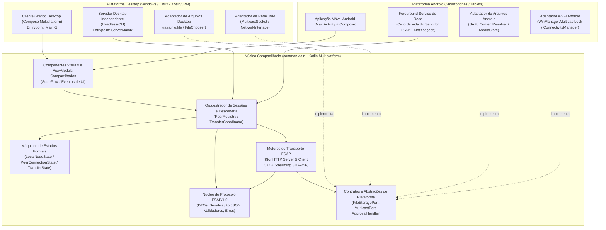

# Arquitetura de Software e Rede — FileShare

> **Status:** Especificação Arquitetural (Milestone M0)  
> **Escopo:** Definição dos componentes Desktop (Cliente GUI e Servidor Independente), Android, Lógica Compartilhada (`commonMain`) e Subsistemas de Rede.

---

## 1. Visão Geral e Princípios Arquiteturais

O **FileShare** adota uma **Arquitetura em Camadas Orientada a Domínio e Protocolo** sobre **Kotlin Multiplatform (KMP)** e **Compose Multiplatform (CMP)**.

Os quatro princípios inegociáveis da arquitetura são:

1. **Protocol-First (FSAP como Fonte Única da Verdade):** Toda comunicação entre dispositivos obedece estritamente ao protocolo da camada de aplicação **FSAP/1.0** ([protocol-fsap.md](file:///home/enzosarmento/Documents/2026.2/redes/fileshare/docs/protocol-fsap.md)). Nenhuma camada de UI conversa diretamente com sockets; toda interação passa pelos contratos e máquinas de estados do protocolo.
2. **Desacoplamento Estrito entre Interface Gráfica e Serviço de Rede:** O motor de rede (Servidor HTTP/TCP receptor e Serviço de Descoberta UDP) não possui qualquer dependência de bibliotecas visuais (`Compose`, `AWT`, `Android View`). No Desktop, o servidor pode ser inicializado e executado como um **executável independente** (`ServerMainKt` / `./gradlew :composeApp:runDesktopServer`), operando em modo *headless* ou controlado pela GUI.
3. **Compartilhamento Pragmático (`commonMain` vs. Plataforma):** Regras de protocolo, DTOs, serialização JSON, máquinas de estados, validação e orquestração de sessões residem em `commonMain`. Acesso ao sistema de arquivos do sistema operacional, seletores nativos, gerenciamento de `MulticastLock` e serviços de segundo plano são isolados por interfaces de plataforma implementadas em `desktopMain` e `androidMain`.
4. **Streaming de Memória Constante $O(1)$:** Arquivos são lidos, transmitidos, hasheados (SHA-256) e gravados em disco em blocos fixos de 64 KB, permitindo transferir arquivos de múltiplos gigabytes tanto em PCs quanto em smartphones com memória restrita.

---

## 2. Diagrama Geral da Arquitetura



---

## 3. Detalhamento dos Componentes Arquiteturais

### 3.1. Aplicação Desktop (Seção 4.1)

A plataforma Desktop (`desktopMain`, compilada para Kotlin/JVM 21) divide-se arquiteturalmente em **duas unidades de execução independentes** que compartilham o mesmo núcleo de domínio e protocolo:

#### A. Servidor Desktop Independente (`br.edu.fileshare.desktop.server.ServerMainKt`)
- **Responsabilidades:**
  - Inicializar o nó receptor FSAP sem carregar a camada gráfica (`Compose`/`Skiko`/`AWT`).
  - Vincular o servidor HTTP/TCP local (porta padrão `53317`, configurável via linha de comando `--port` ou arquivo de configuração).
  - Inicializar o anunciante/ouvinte UDP Multicast (`239.255.70.83:53318`) para anunciar presença na LAN.
  - Receber solicitações de transferência (`TRANSFER_REQUEST`), aplicar a política de confirmação configurada (interativa no terminal CLI, delegada a um ouvinte IPC/UI local ou auto-aprovação restrita a testes) e gerenciar múltiplas recepções simultâneas (`TRANSFER_CONTENT`).
  - Gravar arquivos recebidos em arquivos temporários `.part`, calcular o hash SHA-256 em streaming e consolidar o arquivo final no diretório de downloads configurado.
- **Execução Independente:**
  - Pode ser iniciado isoladamente em qualquer máquina Linux ou Windows via `./gradlew :composeApp:runDesktopServer` (ou script `./scripts/run-desktop-server.sh`), viabilizando testes de conformidade de protocolo, execução em servidores locais sem monitor e validação acadêmica direta de sockets e HTTP.

#### B. Cliente Gráfico Desktop (`br.edu.fileshare.desktop.MainKt`)
- **Responsabilidades:**
  - Fornecer a interface gráfica em Compose Multiplatform para Desktop.
  - Exibir em tempo real a lista de dispositivos descobertos na LAN e permitir a adição manual de dispositivos por endereço IP (`IDENTIFY`).
  - Integrar-se ao seletor nativo de arquivos do sistema operacional para seleção de um ou múltiplos arquivos.
  - Coordenar o envio de arquivos (atuando como Cliente HTTP/TCP FSAP) e exibir barras de progresso, taxa de transferência e controles de cancelamento.
  - Exibir modais de confirmação explícita quando o nó local recebe uma solicitação `TRANSFER_REQUEST`.
- **Relação com o Servidor Desktop:**
  - A camada de UI nunca abre sockets diretamente; ela consome a interface `FileShareNodeService` (via `StateFlow` e comandos assíncronos), mantendo separação total entre apresentação e rede (ver [ADR-002](file:///home/enzosarmento/Documents/2026.2/redes/fileshare/docs/decisions/ADR-002-separacao-cliente-gui-e-servidor-desktop.md)).

---

### 3.2. Aplicação Android (Seção 4.2)

A aplicação Android (`androidMain`) compartilha a lógica de protocolo, serialização, clientes/servidores HTTP e componentes visuais Compose com o Desktop, mas implementa adaptadores específicos para as restrições do sistema operacional móvel:

1. **Gerenciamento de Ciclo de Vida e Segundo Plano (`ForegroundService`):**
   - O Android restringe severamente a execução de sockets de servidor e encerrará conexões TCP/UDP em poucos segundos caso o usuário minimize o aplicativo (por exemplo, ao alternar para outro app enquanto aguarda ou recebe um arquivo grande).
   - **Solução Arquitetural:** Quando o modo de recepção ou uma transferência ativa estiver em andamento, o Android iniciará um `ForegroundService` do tipo `dataSync` com uma notificação persistente mostrando o status do nó e o progresso da transferência (ver [ADR-006](file:///home/enzosarmento/Documents/2026.2/redes/fileshare/docs/decisions/ADR-006-armazenamento-e-ciclo-de-vida-android.md)).
2. **Recepção de Pacotes UDP Multicast (`WifiManager.MulticastLock`):**
   - Por padrão, a pilha Wi-Fi do Android descarta pacotes IP Multicast na camada de driver para economizar bateria.
   - O adaptador `AndroidMulticastLockManager` adquire um `WifiManager.MulticastLock` (`setReferenceCounted(false)`) exclusivamente enquanto a tela de descoberta ou o serviço de recepção estiver ativo, liberando-o imediatamente no encerramento (`STOPPED`).
3. **Acesso a Arquivos (`Storage Access Framework` e `ContentResolver`):**
   - O Android moderno (API 29+ / Scoped Storage) não permite acesso arbitrário por caminhos `java.io.File` a pastas compartilhadas.
   - **Leitura (Envio):** Utiliza `ActivityResultContracts.OpenMultipleDocuments()` retornando `Uri`s (`content://`). Um adaptador `AndroidFileSource` extrai nome (`OpenableColumns.DISPLAY_NAME`), tamanho (`OpenableColumns.SIZE`), calcula o SHA-256 em primeiro passo de leitura por stream (`ContentResolver.openInputStream(uri)`) e transmite o segundo stream durante o `TRANSFER_CONTENT`.
   - **Escrita (Recebimento):** Grava inicialmente o arquivo `.part` no diretório privado de cache do aplicativo (`context.cacheDir/incoming/`) durante a recepção e validação do SHA-256. Somente após a validação bem-sucedida (`VERIFYING` → `COMPLETED`), copia/move atomicamente para a coleção `MediaStore.Downloads` (Android 10+) ou pasta selecionada via SAF (`OpenDocumentTree`).

---

### 3.3. Lógica Compartilhada vs. Específica de Plataforma (Seção 4.3)

A divisão entre `commonMain`, `desktopMain` e `androidMain` segue regras claras para evitar acoplamento indevido:

| Camada / Domínio | Localização (`sourceSet`) | Responsabilidade e Artefatos |
| :--- | :---: | :--- |
| **Contratos e Mensagens FSAP** | `commonMain` | Envelopes JSON, DTOs (`AnnounceMessage`, `TransferRequestMessage`, `ErrorResponse`, etc.), constantes do protocolo, serializadores `kotlinx.serialization` e validadores sintáticos/semânticos. |
| **Máquinas de Estados** | `commonMain` | Implementação pura e determinística de `LocalNodeStateMachine`, `PeerConnectionStateMachine` e `TransferStateMachine`, 100% testáveis em `commonTest` sem rede real. |
| **Repositório de Dispositivos (`PeerRegistry`)** | `commonMain` | Tabela concorrente em memória de dispositivos descobertos, lógica de deduplicação por `deviceId`, atualização de `lastSeenAt` e cálculo de expiração por TTL. |
| **Motor HTTP/TCP (Cliente e Servidor)** | `commonMain` | Rotas Ktor Server CIO e requisições Ktor Client CIO para os endpoints do FSAP (`/fsap/v1/...`), orquestrando leitura/escrita em blocos de 64 KB. |
| **Portas de Plataforma (Interfaces)** | `commonMain` | Interfaces `FileSource`, `FileSink`, `PlatformFilePicker`, `MulticastTransport`, `NetworkInterfaceProvider` e `HashingEngine`. |
| **Adaptadores de Rede UDP e Interfaces Locais** | `desktopMain` / `androidMain` | Implementação baseada em `java.net.MulticastSocket`, enumeração de `java.net.NetworkInterface` e, no Android, controle do `WifiManager.MulticastLock`. |
| **Adaptadores de Sistema de Arquivos** | `desktopMain` / `androidMain` | `DesktopNioFileSink` (`java.nio.file.Path`) no Desktop; `AndroidContentResolverFileSink` (`CacheDir` + `MediaStore`/`SAF`) no Android. |
| **Interface de Usuário (UI)** | `commonMain` + entrypoints em `desktopMain` / `androidMain` | Telas e componentes Compose Multiplatform em `commonMain`; janelas/bandeja Desktop em `desktopMain`; `MainActivity`, permissões e `ForegroundService` em `androidMain`. |

---

## 4. Análise Crítica da Arquitetura de Comunicação e Melhorias Incorporadas (Seção 4.4)

A arquitetura proposta inicialmente (UDP Multicast para descoberta + HTTP sobre TCP para transferência com JSON e binário em streaming) **atende integralmente aos objetivos acadêmicos** da disciplina de Redes de Computadores porque:
- Exercita na prática os dois principais protocolos de transporte da pilha TCP/IP (**UDP** e **TCP**) em cenários onde cada um é tecnicamente superior;
- Exige o desenho formal de um protocolo da camada de aplicação (**FSAP**) com controle explícito de sessão, negociação de capacidade, máquina de estados e tratamento de falhas;
- Permite inspecionar tráfego real em ferramentas como *Wireshark* (tanto datagramas UDP multicast quanto fluxos HTTP/TCP).

Contudo, durante a análise arquitetural desta etapa, identificamos **seis lacunas críticas** em implementações ingênuas desse modelo e incorporamos as seguintes **melhorias arquiteturais** na especificação do FSAP/1.0:

1. **Descoberta Reativa Imediata (`DISCOVER` + `ANNOUNCE`):**
   - *Problema:* Depender apenas de anúncios periódicos (`ANNOUNCE`) faz com que um dispositivo recém-inicializado demore até um ciclo inteiro para perceber os pares ou ser percebido.
   - *Melhoria:* Ao entrar no estado `DISCOVERING`, o nó emite um datagrama `DISCOVER` para o grupo multicast; todos os nós ativos respondem com um `ANNOUNCE` com pequeno *jitter* aleatório (50–300 ms) para evitar tempestade de colisões UDP no Wi-Fi.
2. **Despedida Graciosa (`BYE`):**
   - *Problema:* Sem notificação de saída, dispositivos encerrados normalmente continuam aparecendo como disponíveis na tela dos colegas até o estouro do TTL (18 s).
   - *Melhoria:* O protocolo define a mensagem UDP `BYE` enviada no encerramento normal, removendo imediatamente o nó das listas remotas.
3. **Token de Autorização Efêmero por Transferência (`transferToken`):**
   - *Problema:* Em uma LAN compartilhada (ex: laboratório da universidade), se o servidor aceitar uma transferência e apenas abrir um endpoint de upload genérico, outro host malicioso na mesma sub-rede poderia injetar arquivos não solicitados.
   - *Melhoria:* Ao aceitar um `TRANSFER_REQUEST`, o destinatário gera um `transferToken` criptograficamente aleatório vinculado ao `transferId` e aos `fileId`s autorizados, exigido no cabeçalho `X-FSAP-Transfer-Token` de cada envio `TRANSFER_CONTENT`.
4. **Suporte a Lotes de Múltiplos Arquivos em uma Única Sessão:**
   - *Problema:* Solicitar confirmação do usuário individualmente para 10 arquivos seguidos degrada a experiência e multiplica handshakes.
   - *Melhoria:* A mensagem `TRANSFER_REQUEST` transporta um manifesto com `1..N` arquivos (cada um com seu próprio `fileId`, `fileName`, `sizeBytes` e `sha256`), permitindo aprovação única do lote e transferência sequencial ou paralela controlada de cada arquivo seguido de `TRANSFER_COMPLETE`.
5. **Isolamento de Escrita com Arquivo `.part` e Validação Incremental:**
   - *Problema:* Se a conexão TCP cair em 99% da transferência ou se o hash SHA-256 divergir, gravar diretamente no caminho final deixaria um arquivo corrompido visível ao usuário.
   - *Melhoria:* Todo fluxo recebido é gravado em `<transferId>_<fileId>.part` enquanto o digest SHA-256 é atualizado chunk a chunk; se houver falha de rede, cancelamento ou divergência de hash, o arquivo `.part` é imediatamente excluído.
6. **Fallback Determinístico de Conexão Manual por IP (`IDENTIFY`):**
   - *Problema:* Redes universitárias e roteadores com *AP Isolation* bloqueiam UDP Multicast.
   - *Melhoria:* O usuário pode informar o IP (e porta opcional) do par; o cliente realiza uma chamada HTTP/TCP `IDENTIFY` diretamente para o servidor alvo, obtendo a mesma estrutura `DeviceIdentity` do multicast e registrando o par na tabela de dispositivos para transferência normal.

---

## 5. Organização Interna de Pacotes Planejada

Dentro de `composeApp/src/`, o código a ser desenvolvido nas Milestones M1 a M6 deverá respeitar a seguinte estrutura modular de pacotes sob `br.edu.fileshare`:

```text
br.edu.fileshare
├── ProjectInfo.kt                  # Metadados da fundacao (existente em M0)
├── domain/                         # Entidades de dominio (Device, FileMetadata, TransferSession)
├── protocol/                       # Implementacao do protocolo FSAP/1.0 (commonMain)
│   ├── model/                      # DTOs serializaveis (AnnounceDto, TransferRequestDto, ErrorDto)
│   ├── validation/                 # Validadores sintaticos e semanticos de mensagens
│   ├── statemachine/               # LocalNodeStateMachine, PeerStateMachine, TransferStateMachine
│   └── error/                      # Catalogo FsapErrorCode e excecoes de protocolo
├── network/                        # Motores de rede (sem acoplamento com UI)
│   ├── discovery/                  # PeerRegistry, DiscoveryCoordinator, MulticastTransport
│   ├── server/                     # FsapHttpServer (Ktor CIO), rotas HTTP e gestao de sessoes
│   ├── client/                     # FsapHttpClient (Ktor CIO), envio streaming e polling/status
│   └── streaming/                  # ChunkedStreamCopy, IncrementalSha256Channel
├── storage/                        # Portas de leitura/escrita segura e sanitizacao de nomes
├── ui/                             # Camada visual compartilhada (Compose Multiplatform)
│   ├── state/                      # ViewModels / ScreenStates (StateFlow)
│   ├── components/                 # Componentes visuais reutilizaveis
│   └── screens/                    # Telas (Home/Discovery, Send, ReceiveApproval, TransferProgress)
├── desktop/                        # Especifico Desktop (desktopMain)
│   ├── Main.kt                     # Entrypoint do Cliente Grafico Desktop
│   ├── server/
│   │   └── ServerMain.kt           # Entrypoint independente do Servidor Desktop (Headless/CLI)
│   ├── network/                    # JvmMulticastTransport, JvmNetworkInterfaceProvider
│   └── storage/                    # DesktopNioFileStorage, DesktopFilePicker
└── android/                        # Especifico Android (androidMain)
    ├── MainActivity.kt             # Entrypoint da UI Android
    ├── service/                    # FsapForegroundService (manutencao de servidor e MulticastLock)
    ├── network/                    # AndroidMulticastLock, AndroidMulticastTransport
    └── storage/                    # AndroidSafFileStorage, MediaStoreDownloadsCommitter
```

---

## 6. Riscos Técnicos Identificados e Estratégias de Mitigação

| ID | Risco Técnico | Probabilidade | Impacto | Estratégia de Mitigação Planejada |
| :--- | :--- | :---: | :---: | :--- |
| **RISK-01** | Bloqueio de pacotes UDP Multicast em redes Wi-Fi de laboratório ou roteadores domésticos com *IGMP Snooping* mal configurado. | Alta | Alto | Implementar busca ativa `DISCOVER`, envio de multicast em todas as interfaces Wi-Fi/Ethernet válidas e fluxo completo de **Conexão Manual por IP** via mensagem `IDENTIFY` sobre TCP. |
| **RISK-02** | Seleção incorreta de interface de rede (ex: Docker `docker0`, `veth`, WSL2 ou VPN) pelo `MulticastSocket` padrão da JVM. | Alta | Médio | Não usar a interface default cega do SO; enumerar `NetworkInterface.getNetworkInterfaces()`, filtrando interfaces `isUp`, `!isLoopback`, `supportsMulticast` e com endereço IPv4 de sub-rede privada (`192.168.x.x`, `10.x.x.x`, `172.16-31.x.x`). |
| **RISK-03** | `OutOfMemoryError` ao enviar ou receber arquivos grandes (ex: imagens ISO ou vídeos de > 1 GB) em dispositivos Android. | Média | Crítico | Proibir o uso de `ByteArray` para o conteúdo do arquivo (`readBytes()`); utilizar exclusivamente canais de streaming em chunks de 64 KB com `MessageDigest` incremental. |
| **RISK-04** | Suspensão do processo Android ou perda do `MulticastLock` quando a tela apaga ou o usuário alterna de aplicativo durante uma transferência longa. | Alta | Alto | Executar o servidor FSAP e as sessões ativas dentro de um `ForegroundService` (`foregroundServiceType="dataSync"`) com `PartialWakeLock` e `MulticastLock` gerenciados por referência. |
| **RISK-05** | Cálculo prévio do SHA-256 de arquivos muito grandes causar percepção de lentidão antes do envio do `TRANSFER_REQUEST`. | Média | Médio | Executar a leitura de preparação em `Dispatchers.IO` com indicador visual de "Preparando arquivo e calculando hash SHA-256 (X%)" cancelável pelo usuário antes do envio da requisição. |
| **RISK-06** | Conflito de porta TCP (`53317`) quando o Servidor Desktop Independente e o Cliente GUI são executados na mesma máquina durante testes locais. | Média | Médio | Permitir parametrização de porta via CLI/configuração (`--port 53319`) e anunciar dinamicamente a porta HTTP real (`httpPort`) dentro do payload da mensagem UDP `ANNOUNCE`. |

---

## 7. Decisões Arquiteturais Documentadas (ADRs)

Todas as decisões estruturais estão registradas em `docs/decisions/`:
- [ADR-001: Adoção de Kotlin Multiplatform e Compose Multiplatform](file:///home/enzosarmento/Documents/2026.2/redes/fileshare/docs/decisions/ADR-001-adocao-kmp-e-compose-multiplatform.md) — **Aprovada**
- [ADR-002: Separação entre Cliente GUI e Servidor Desktop Independente](file:///home/enzosarmento/Documents/2026.2/redes/fileshare/docs/decisions/ADR-002-separacao-cliente-gui-e-servidor-desktop.md) — **Aprovada**
- [ADR-003: Arquitetura Híbrida UDP Multicast e HTTP/TCP](file:///home/enzosarmento/Documents/2026.2/redes/fileshare/docs/decisions/ADR-003-arquitetura-hibrida-udp-multicast-e-http-tcp.md) — **Aprovada**
- [ADR-004: Escolha de Ktor CIO para HTTP/TCP e `java.net.MulticastSocket` para UDP](file:///home/enzosarmento/Documents/2026.2/redes/fileshare/docs/decisions/ADR-004-escolha-ktor-vs-java-net-sockets.md) — **Proposta Técnica (Pendente de Aprovação da Equipe)**
- [ADR-005: Estratégia de Streaming em Chunks e Integridade SHA-256](file:///home/enzosarmento/Documents/2026.2/redes/fileshare/docs/decisions/ADR-005-estrategia-streaming-e-integridade-sha256.md) — **Proposta Técnica (Pendente de Aprovação da Equipe)**
- [ADR-006: Armazenamento Segura e Ciclo de Vida no Android](file:///home/enzosarmento/Documents/2026.2/redes/fileshare/docs/decisions/ADR-006-armazenamento-e-ciclo-de-vida-android.md) — **Proposta Técnica (Pendente de Aprovação da Equipe)**

