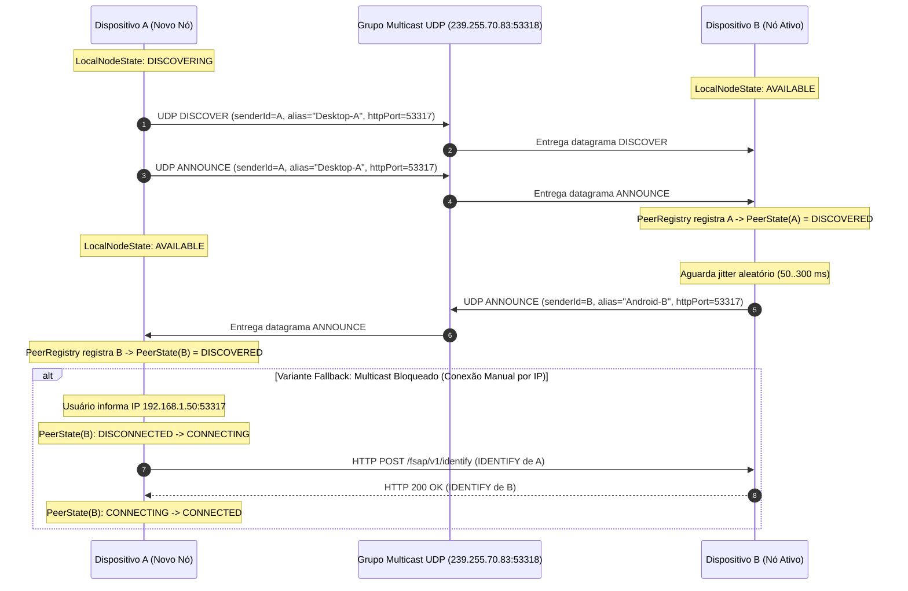
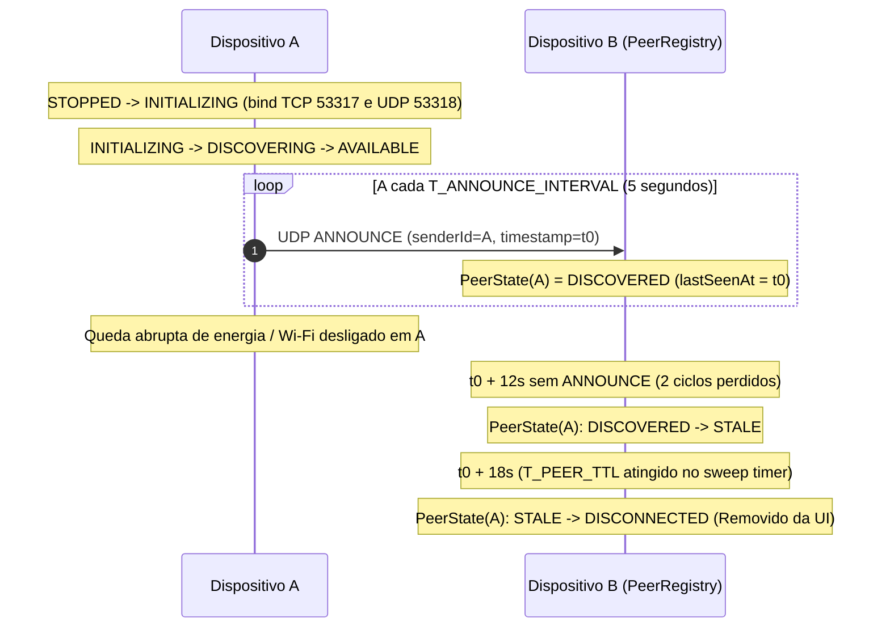
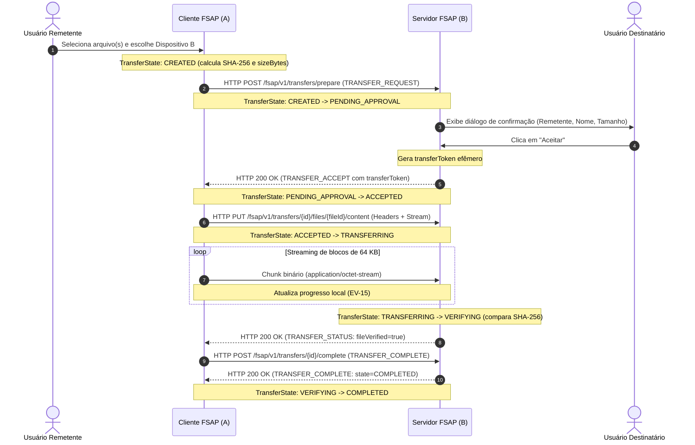
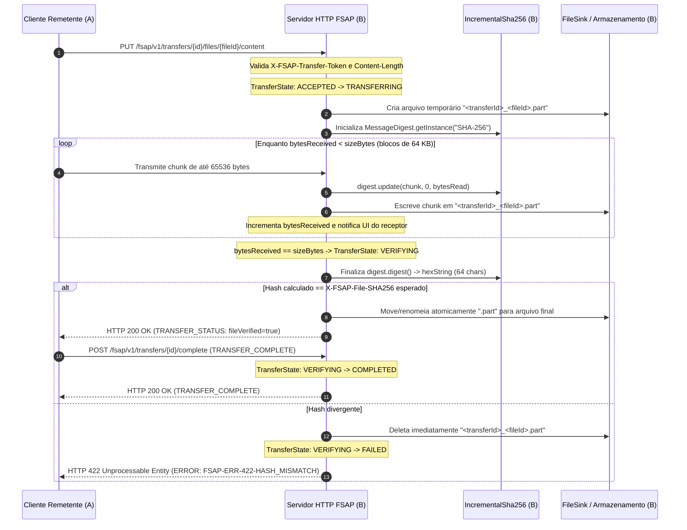
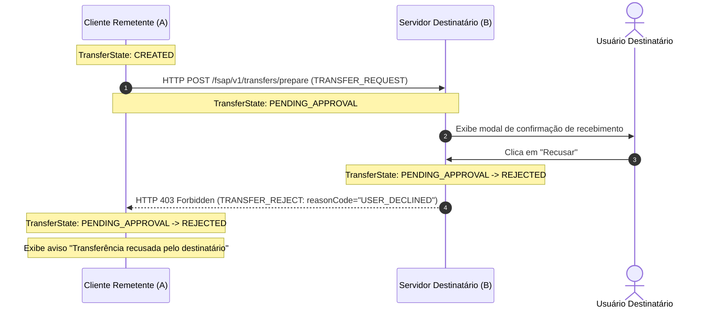
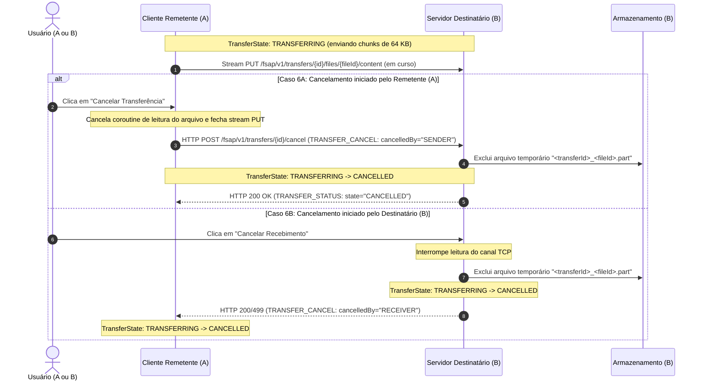
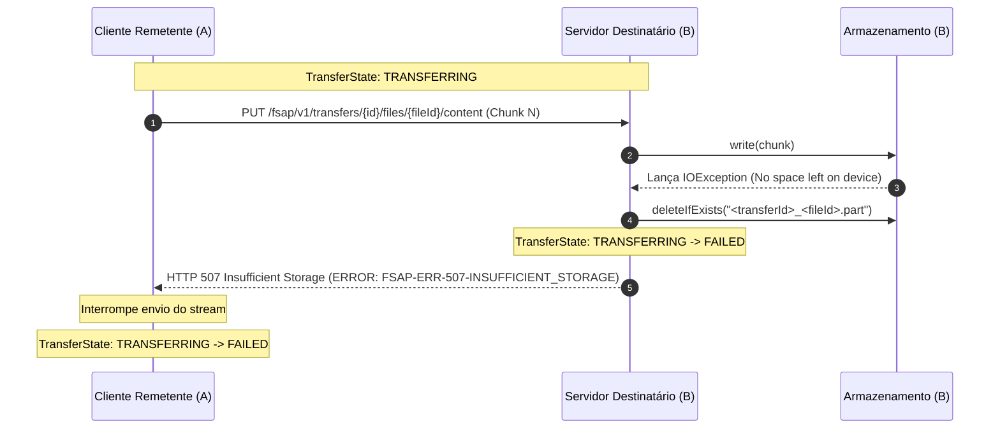
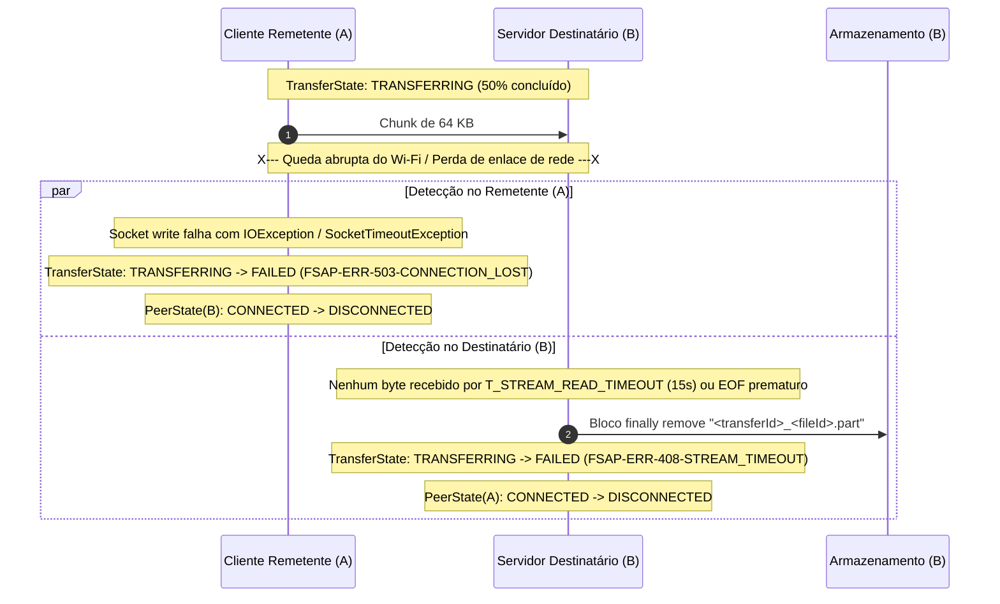
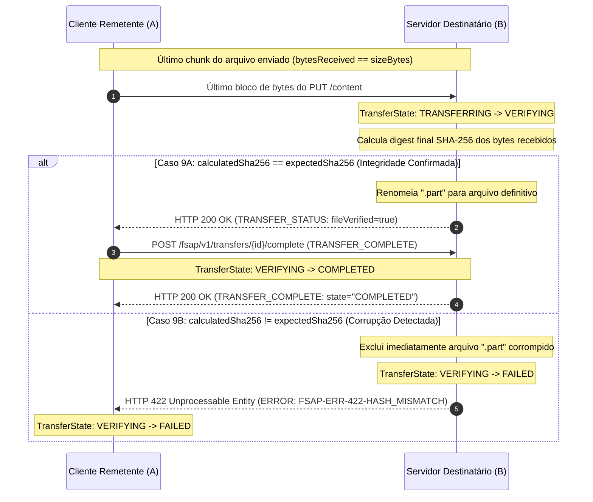
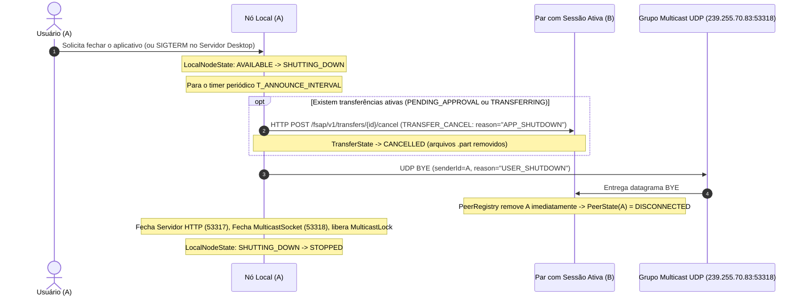

# Fluxos Completos de Comunicação — Protocolo FSAP/1.0

> **Status:** Especificação Normativa Aprovada (FSAP/1.0 — Seção 5.6)  
> **Escopo:** Diagramas de sequência formais em Mermaid e análise de estados, mensagens, resultados e falhas para os 10 cenários operacionais do FileShare.

---

## 1. Fluxo 1: Descoberta de Dois Dispositivos (Multicast UDP e Variante Manual TCP)

- **Dispositivos Envolvidos:** `Dispositivo A` (recém-iniciado na LAN) e `Dispositivo B` (já ativo na LAN).
- **Mensagens Trocadas:** `DISCOVER` (UDP), `ANNOUNCE` (UDP) — ou `IDENTIFY` (HTTP/TCP) na variante manual.
- **Estados Envolvidos:**
  - `Dispositivo A`: `LocalNodeState: DISCOVERING` → `AVAILABLE`; `PeerConnectionState(B): DISCONNECTED` → `DISCOVERED`.
  - `Dispositivo B`: `LocalNodeState: AVAILABLE`; `PeerConnectionState(A): DISCONNECTED` → `DISCOVERED`.
- **Resultados Esperados:** Ambos os dispositivos passam a constar mutuamente em suas respectivas `PeerRegistry` com IP, `httpPort`, `alias` e `deviceId` atualizados.
- **Possíveis Falhas:** Roteador Wi-Fi com *AP Isolation* bloqueia `239.255.70.83:53318` (mitigado pelo bloco alternativo de Conexão Manual por IP usando `IDENTIFY`).

---

## 2. Fluxo 2: Inicialização, Anúncio Periódico de Presença e Expiração por TTL

- **Dispositivos Envolvidos:** `Dispositivo A` (Anunciante) e `Dispositivo B` (Observador).
- **Mensagens Trocadas:** `ANNOUNCE` periódico a cada `5000 ms` (`T_ANNOUNCE_INTERVAL`).
- **Estados Envolvidos:**
  - `Dispositivo A`: `STOPPED` → `INITIALIZING` → `DISCOVERING` → `AVAILABLE`.
  - `Dispositivo B`: `PeerConnectionState(A): DISCONNECTED` → `DISCOVERED` → `STALE` (após 12 s sem anúncio) → `DISCONNECTED` (após 18 s sem anúncio).
- **Resultados Esperados:** Presença mantida ativa enquanto houver batimentos periódicos e remoção automática caso o `Dispositivo A` perca conectividade sem enviar `BYE`.
- **Possíveis Falhas:** `BindException` na porta `53317`/`53318` levando `Dispositivo A` ao estado `FAULTED`.

---

## 3. Fluxo 3: Envio de Arquivo com Aceitação (Perspectiva Ponta a Ponta)

- **Dispositivos Envolvidos:** `Cliente Remetente (A)` e `Servidor Destinatário (B)`.
- **Mensagens Trocadas:** `TRANSFER_REQUEST`, `TRANSFER_ACCEPT`, `TRANSFER_CONTENT`, `TRANSFER_STATUS`, `TRANSFER_COMPLETE`.
- **Estados Envolvidos (`TransferState`):** `CREATED` → `PENDING_APPROVAL` → `ACCEPTED` → `TRANSFERRING` → `VERIFYING` → `COMPLETED`.
- **Resultados Esperados:** Arquivo transmitido integralmente em chunks de 64 KB, validado por SHA-256 e confirmado por ambas as partes.
- **Possíveis Falhas:** Timeout de aprovação (`60 s`), token expirado (`30 s`) ou queda de conexão TCP.

---

## 4. Fluxo 4: Recebimento de Arquivo (Perspectiva Interna do Servidor e Armazenamento Seguro)

- **Dispositivos Envolvidos:** `Cliente Remetente (A)`, `Servidor FSAP Receptor (B)` e `Subsistema de Arquivos / Hashing (B)`.
- **Mensagens Trocadas:** `TRANSFER_CONTENT`, `TRANSFER_STATUS`, `TRANSFER_COMPLETE`.
- **Estados Envolvidos (`TransferState` no Destinatário):** `ACCEPTED` → `TRANSFERRING` → `VERIFYING` → `COMPLETED`.
- **Resultados Esperados:** Os dados são gravados exclusivamente em arquivo `.part` durante a recepção, o hash SHA-256 é calculado incrementalmente sem releitura do disco, e o arquivo final só é exposto ao usuário após confirmação do digest.
- **Possíveis Falhas:** `FSAP-ERR-507-INSUFFICIENT_STORAGE`, `FSAP-ERR-422-HASH_MISMATCH`.

---

## 5. Fluxo 5: Recusa de Transferência pelo Destinatário

- **Dispositivos Envolvidos:** `Cliente Remetente (A)` e `Servidor Destinatário (B)`.
- **Mensagens Trocadas:** `TRANSFER_REQUEST`, `TRANSFER_REJECT`.
- **Estados Envolvidos (`TransferState`):** `CREATED` → `PENDING_APPROVAL` → `REJECTED`.
- **Resultados Esperados:** Nenhum byte de conteúdo de arquivo é transmitido na rede; nenhum arquivo `.part` é criado no disco do destinatário; o remetente é informado imediatamente da recusa.
- **Possíveis Falhas:** Usuário destinatário não interagir em 60 s (resultando em `FAILED` por `FSAP-ERR-408-APPROVAL_TIMEOUT` em vez de `REJECTED`).

---

## 6. Fluxo 6: Cancelamento de Transferência em Andamento

- **Dispositivos Envolvidos:** `Cliente Remetente (A)` e `Servidor Destinatário (B)`.
- **Mensagens Trocadas:** `TRANSFER_CONTENT` (interrompido) e `TRANSFER_CANCEL`.
- **Estados Envolvidos (`TransferState`):** `TRANSFERRING` → `CANCELLED` (ou `PENDING_APPROVAL` → `CANCELLED`).
- **Resultados Esperados:** Interrupção imediata do envio de chunks, fechamento limpo do canal e exclusão obrigatória do arquivo `.part` no destinatário.
- **Possíveis Falhas:** Perda de conectividade simultânea ao envio do `TRANSFER_CANCEL` (tratada pelo bloco `finally` que limpa o `.part` em ambos os casos).

---

## 7. Fluxo 7: Falha Durante o Envio (Erro de Armazenamento / Falta de Espaço)

- **Dispositivos Envolvidos:** `Cliente Remetente (A)` e `Servidor Destinatário (B)`.
- **Mensagens Trocadas:** `TRANSFER_CONTENT`, `ERROR` (`FSAP-ERR-507-INSUFFICIENT_STORAGE` ou `FSAP-ERR-500-STORAGE_IO_ERROR`).
- **Estados Envolvidos (`TransferState`):** `TRANSFERRING` → `FAILED`.
- **Resultados Esperados:** Quando o disco do destinatário fica cheio ou sofre erro de escrita durante o streaming, o servidor interrompe imediatamente a recepção, remove o arquivo `.part` parcial e devolve o envelope padronizado `ERROR`.
- **Possíveis Falhas:** Falha secundária ao tentar apagar o `.part` (registrada em log de erro crítico).

---

## 8. Fluxo 8: Desconexão Inesperada no Meio da Transferência

- **Dispositivos Envolvidos:** `Cliente Remetente (A)` e `Servidor Destinatário (B)`.
- **Mensagens Trocadas:** Interrupção abrupta do stream TCP (`RST` ou timeout de leitura de `15 s` `T_STREAM_READ_TIMEOUT`).
- **Estados Envolvidos:**
  - `TransferState`: `TRANSFERRING` → `FAILED`.
  - `PeerConnectionState`: `CONNECTED` → `DISCONNECTED`.
- **Resultados Esperados:** Nenhuma coroutine fica travada indefinidamente; ambos os lados detectam a perda de conexão em no máximo `15 s` (`T_STREAM_READ_TIMEOUT`), o destinatário apaga o arquivo `.part` órfão e a UI informa a queda de conexão (`FSAP-ERR-503-CONNECTION_LOST` / `FSAP-ERR-408-STREAM_TIMEOUT`).

---

## 9. Fluxo 9: Verificação de Integridade SHA-256 (Sucesso vs. Corrupção de Dados)

- **Dispositivos Envolvidos:** `Cliente Remetente (A)` e `Servidor Destinatário (B)`.
- **Mensagens Trocadas:** `TRANSFER_CONTENT`, `TRANSFER_STATUS`, `TRANSFER_COMPLETE` ou `ERROR` (`FSAP-ERR-422-HASH_MISMATCH`).
- **Estados Envolvidos (`TransferState`):** `TRANSFERRING` → `VERIFYING` → `COMPLETED` (se íntegro) ou `FAILED` (se corrompido).
- **Resultados Esperados:** Garantia matemática de que o arquivo salvo no disco do destinatário é bit a bit idêntico ao arquivo original do remetente.

---

## 10. Fluxo 10: Encerramento Normal da Aplicação (Graceful Shutdown)

- **Dispositivos Envolvidos:** `Nó em Encerramento (A)`, `Par com Transferência Ativa (B)` e `Grupo Multicast UDP`.
- **Mensagens Trocadas:** `TRANSFER_CANCEL` (se houver sessão ativa) e `BYE` (UDP Multicast).
- **Estados Envolvidos:**
  - `LocalNodeState(A)`: `AVAILABLE` → `SHUTTING_DOWN` → `STOPPED`.
  - `TransferState`: `TRANSFERRING` → `CANCELLED`.
  - `PeerConnectionState(A)` nos vizinhos: `DISCOVERED` → `DISCONNECTED`.
- **Resultados Esperados:** Cancelamento limpo de sessões em curso, remoção de arquivos `.part`, notificação imediata de saída via `BYE` e liberação de portas TCP/UDP em até `2000 ms` (`T_SHUTDOWN_GRACE`).

