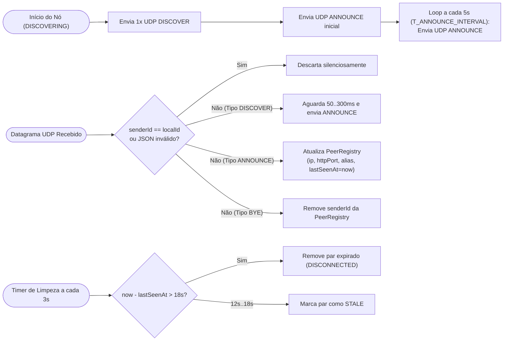

# Subsistema de Descoberta de Dispositivos em Rede Local (UDP Multicast + Fallback TCP)

> **Status:** Especificação Técnica (Milestone M0)  
> **Relacionado a:** [protocol-fsap.md](file:///home/enzosarmento/Documents/2026.2/redes/fileshare/docs/protocol-fsap.md), [protocol-messages.md](file:///home/enzosarmento/Documents/2026.2/redes/fileshare/docs/protocol-messages.md)

---

## 1. Visão Geral da Descoberta

O subsistema de descoberta permite que nós FileShare encontrem uns aos outros automaticamente dentro do mesmo domínio de broadcast/multicast da rede local (LAN/WLAN) sem depender de servidores centrais ou configuração manual, oferecendo ainda um mecanismo determinístico de **Conexão Manual por IP** quando a infraestrutura de rede bloquear tráfego multicast.

### Parâmetros de Rede do Grupo Multicast
- **Endereço IPv4 do Grupo Multicast:** `239.255.70.83` (pertencente à faixa `239.255.0.0/16` — *IPv4 Local Scope*, RFC 2365; os bytes `70.83` correspondem a `'F'` e `'S'` em ASCII).
- **Porta UDP:** `53318`
- **TTL do Pacote IP Multicast (`Time-To-Live`):** `1` (restrito à sub-rede local imediata, não atravessando roteadores).
- **Tamanho do Buffer de Recepção do Datagrama:** `1024 bytes`.
- **Opção de Socket:** `SO_REUSEADDR = true` (permite que múltiplos processos em teste local ou reinicializações rápidas façam bind na porta `53318`).

---

## 2. Seleção de Interfaces de Rede (`NetworkInterfaceProvider`)

Um dos problemas mais comuns em aplicações Java/Kotlin que utilizam `MulticastSocket` em Linux, Windows e Android é o bind automático na interface de rede incorreta (ex: interfaces virtuais do Docker `docker0`, `veth*`, WSL2 `vEthernet`, Hyper-V, VirtualBox ou túneis VPN `tun0`/`wg0`).

Para garantir funcionamento confiável, a implementação de `NetworkInterfaceProvider` (em `desktopMain` e `androidMain`) deve enumerar todas as interfaces via `NetworkInterface.getNetworkInterfaces()` e aplicar o seguinte filtro determinístico:

1. `networkInterface.isUp == true`
2. `networkInterface.isLoopback == false`
3. `networkInterface.supportsMulticast() == true`
4. `networkInterface.isVirtual == false`
5. Descartar interfaces cujo nome (`name` ou `displayName` em lowercase) comece com prefixos virtuais conhecidos: `docker`, `br-`, `veth`, `virbr`, `vmnet`, `vboxnet`, `tun`, `tap`, `wg`, `tailscale`.
6. Possuir pelo menos um `Inet4Address` válido de escopo privado RFC 1918 (`10.0.0.0/8`, `172.16.0.0/12` ou `192.168.0.0/16`).

O socket multicast deve realizar `joinGroup(InetSocketAddress("239.255.70.83", 53318), netIf)` e emitir datagramas `ANNOUNCE`/`DISCOVER` explicitamente nas interfaces físicas selecionadas.

---

## 3. Dinâmica de Anúncio, Busca Ativa e Expiração (`PeerRegistry`)

### Regras da `PeerRegistry` (em `commonMain`)
- A chave primária da tabela de dispositivos descobertos é o `deviceId` (UUID v4), **e não o endereço IP** (caso o IP mude ou o dispositivo seja visto em múltiplas interfaces, o registro é atualizado).
- O endereço IPv4 utilizado para abrir conexões TCP futuras com o par é extraído diretamente de `DatagramPacket.address.hostAddress` (endereço de origem real do pacote IP na LAN) combinado com o campo `payload.httpPort` do `ANNOUNCE`.

---

## 4. Particularidades do Android (`WifiManager.MulticastLock`)

No sistema operacional Android, o chip Wi-Fi filtra pacotes multicast por padrão para economizar energia. Portanto, a implementação em `androidMain` deve:
1. Declarar `<uses-permission android:name="android.permission.CHANGE_WIFI_MULTICAST_STATE" />` no `AndroidManifest.xml`.
2. Antes de iniciar o listener UDP, obter o serviço `WifiManager` e criar o lock:
   - `multicastLock = wifiManager.createMulticastLock("fileshare_fsap_multicast_lock")`
   - `multicastLock.setReferenceCounted(false)`
   - `multicastLock.acquire()`
3. Garantir no bloco `finally` / `onDestroy` do `ForegroundService` a chamada `if (multicastLock.isHeld) multicastLock.release()`.

---

## 5. Alternativa de Conexão Manual por Endereço IP

Quando a rede local bloquear multicast (ex: redes corporativas, universitárias ou roteadores com *Isolation* parcial que ainda permitem TCP unicast entre IPs da mesma sub-rede):
1. O usuário aciona a opção **"Conectar por IP"** na interface e informa o endereço IPv4 (ex: `192.168.1.45`) e, opcionalmente, a porta TCP (padrão `53317`).
2. O cliente realiza uma requisição HTTP/TCP `POST /fsap/v1/identify` (mensagem `IDENTIFY`) com timeout de conexão de `5000 ms` (`T_TCP_CONNECT_TIMEOUT`).
3. Se o servidor responder `200 OK` com seu envelope `IDENTIFY` válido e versão compatível (`1.x`), o dispositivo remoto é inserido na `PeerRegistry` com estado `CONNECTED` (marcado com origem `MANUAL_IP`, isento de expiração pelo sweep timer de multicast enquanto responder em TCP) e fica imediatamente disponível para envio de arquivos.

