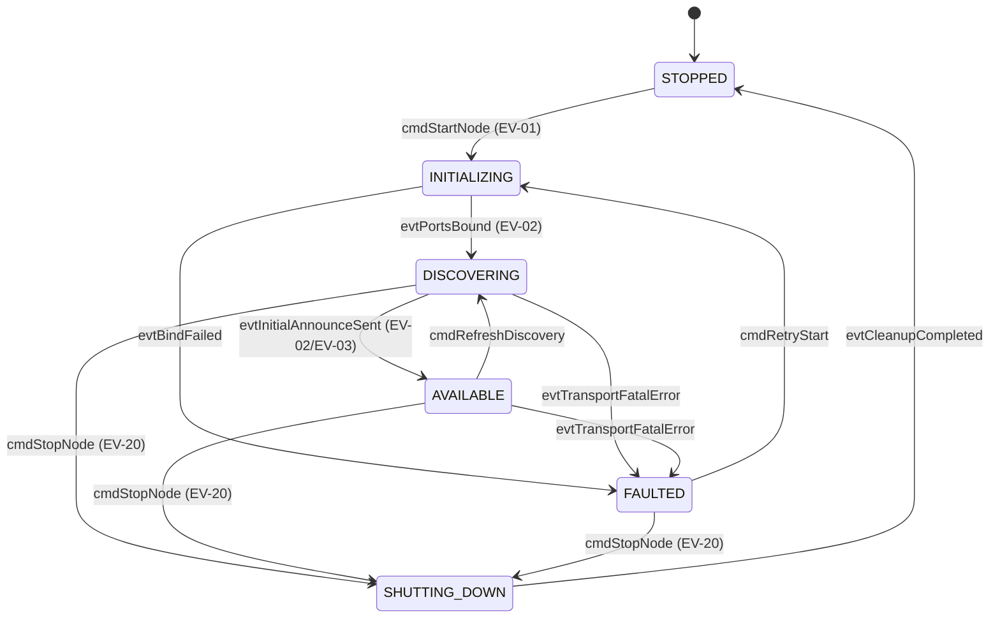
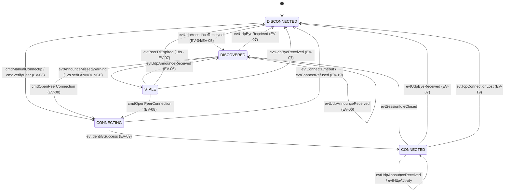
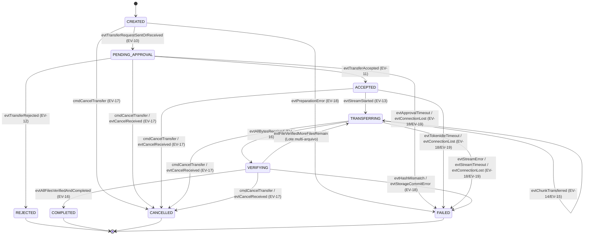

# Máquinas de Estados Formais — Protocolo FSAP/1.0

> **Status:** Especificação Normativa (Milestone M0 — Seção 5.3)  
> **Escopo:** Definição formal das máquinas de estados determinísticas para o Nó Local, Conexões com Pares Remotos e Sessões de Transferência de Arquivos.

---

## 1. Avaliação Arquitetural e Separação por Entidade

Na análise inicial do problema foram sugeridos os estados `STOPPED`, `INITIALIZING`, `DISCOVERING`, `AVAILABLE`, `CONNECTING`, `CONNECTED`, `DISCONNECTED` para dispositivos, e `CREATED`, `PENDING_APPROVAL`, `ACCEPTED`, `REJECTED`, `TRANSFERRING`, `VERIFYING`, `COMPLETED`, `CANCELLED`, `FAILED` para transferências.

### 1.1. Por que Separar o Estado do Nó Local do Estado da Conexão com cada Par Remoto?
Em um sistema distribuído em LAN com suporte a **múltiplas conexões simultâneas (RF-15)**, se `AVAILABLE` (estado do serviço local) e `CONNECTING`/`CONNECTED` (estado da relação com um par específico) pertencessem a uma única máquina de estados global do dispositivo, o dispositivo deixaria de estar `AVAILABLE` para outros colegas no instante em que iniciasse um handshake `CONNECTING` com um par, ou não conseguiria representar que está simultaneamente `CONNECTED` ao *Dispositivo B* e `DISCONNECTED` do *Dispositivo C*.

Portanto, a arquitetura formaliza **três máquinas de estados ortogonais e determinísticas**, contemplando 100% dos estados sugeridos e adicionando os estados de guarda necessários (`SHUTTING_DOWN`, `FAULTED`, `DISCOVERED`, `STALE`):

1. **Máquina 1 — Ciclo de Vida do Nó Local (`LocalNodeState`):** Governa o serviço de rede do próprio dispositivo (`STOPPED`, `INITIALIZING`, `DISCOVERING`, `AVAILABLE`, `SHUTTING_DOWN`, `FAULTED`).
2. **Máquina 2 — Estado de Presença e Conexão por Par Remoto (`PeerConnectionState`):** Instanciada por cada `deviceId` remoto conhecido na `PeerRegistry` (`DISCONNECTED`, `DISCOVERED`, `CONNECTING`, `CONNECTED`, `STALE`).
3. **Máquina 3 — Sessão de Transferência (`TransferState`):** Instanciada por cada `transferId` ativo (`CREATED`, `PENDING_APPROVAL`, `ACCEPTED`, `REJECTED`, `TRANSFERRING`, `VERIFYING`, `COMPLETED`, `CANCELLED`, `FAILED`).

---

## 2. Máquina de Estados 1: Ciclo de Vida do Nó Local (`LocalNodeState`)

### 2.1. Diagrama de Estados (`LocalNodeState`)

### 2.2. Condições de Entrada (`entry`) e Saída (`exit`) — `LocalNodeState`

| Estado | Condição de Entrada (`onEnter`) | Invariante de Permanência | Condição de Saída (`onExit`) |
| :--- | :--- | :--- | :--- |
| **`STOPPED`** | Estado inicial do processo ou conclusão do `SHUTTING_DOWN`. Nenhum socket aberto. | Zero portas TCP/UDP vinculadas; `MulticastLock` liberado. | Comando explícito de inicialização (`cmdStartNode`). |
| **`INITIALIZING`** | `cmdStartNode` invocado. Carrega/gera `deviceId`, valida diretório de download e faz bind do socket TCP (`53317`) e UDP (`53318`). | Recursos locais sendo alocados (transição rápida `< 2 s`). | Sucesso no bind dos sockets (`evtPortsBound`) ou falha fatal de I/O (`evtBindFailed`). |
| **`DISCOVERING`** | Sockets vinculados; ingresso no grupo IGMP `239.255.70.83`; emissão do probe ativo `DISCOVER` e do primeiro `ANNOUNCE`. | Listener UDP ativo coletando respostas imediatas da LAN. | Emissão do primeiro ciclo `ANNOUNCE` concluída (`evtInitialAnnounceSent`) ou comando de parada. |
| **`AVAILABLE`** | Nó visível na rede local e pronto para aceitar `IDENTIFY` e `TRANSFER_REQUEST`. | Timer `T_ANNOUNCE_INTERVAL` (5 s) e `T_PEER_SWEEP_INTERVAL` (3 s) em execução contínua. | Solicitação de encerramento (`cmdStopNode`), refresh manual ou erro fatal de interface de rede. |
| **`FAULTED`** | Falha ao abrir porta TCP/UDP (ex: `BindException`) ou perda total da interface de rede ativa. | Serviço suspenso; erro exposto à UI/CLI. | Comando de nova tentativa (`cmdRetryStart`) ou parada (`cmdStopNode`). |
| **`SHUTTING_DOWN`** | Recebimento de `cmdStopNode` (EV-20). | Envia `TRANSFER_CANCEL` para sessões ativas, envia datagrama UDP `BYE` e fecha sockets em até `T_SHUTDOWN_GRACE` (2 s). | Todos os descritores de arquivo/socket fechados e arquivos `.part` removidos (`evtCleanupCompleted`). |

### 2.3. Tabela Completa de Transições Permitidas — `LocalNodeState`

| Estado Atual | Evento Gatilho | Estado Resultante | Ação Executada na Transição |
| :--- | :--- | :--- | :--- |
| `STOPPED` | `cmdStartNode` (`EV-01`) | `INITIALIZING` | Inicializa identidade e abre sockets TCP/UDP. |
| `INITIALIZING` | `evtPortsBound` (`EV-02`) | `DISCOVERING` | Adquire `MulticastLock` (Android), faz `joinGroup` e envia `DISCOVER`. |
| `INITIALIZING` | `evtBindFailed` | `FAULTED` | Fecha recursos parciais e reporta código de falha local. |
| `DISCOVERING` | `evtInitialAnnounceSent` (`EV-03`) | `AVAILABLE` | Inicia jobs periódicos de anúncio (5 s) e limpeza de TTL (3 s). |
| `DISCOVERING` | `evtTransportFatalError` | `FAULTED` | Interrompe listener UDP e notifica camada superior. |
| `DISCOVERING` | `cmdStopNode` (`EV-20`) | `SHUTTING_DOWN` | Envia `BYE` e inicia fechamento de sockets. |
| `AVAILABLE` | `cmdRefreshDiscovery` | `DISCOVERING` | Envia novo datagrama `DISCOVER` imediato na LAN. |
| `AVAILABLE` | `evtTransportFatalError` | `FAULTED` | Cancela sessões ativas e reporta queda da interface de rede. |
| `AVAILABLE` | `cmdStopNode` (`EV-20`) | `SHUTTING_DOWN` | Cancela transferências ativas, envia `BYE` multicast e fecha sockets. |
| `FAULTED` | `cmdRetryStart` | `INITIALIZING` | Reinicia tentativa de alocação de portas e interface. |
| `FAULTED` | `cmdStopNode` (`EV-20`) | `SHUTTING_DOWN` | Libera recursos residuais. |
| `SHUTTING_DOWN` | `evtCleanupCompleted` | `STOPPED` | Cancela `CoroutineScope` do nó de rede. |

---

## 3. Máquina de Estados 2: Conexão e Presença de Par Remoto (`PeerConnectionState`)

Esta máquina modela o ciclo de vida de cada dispositivo remoto na visão do nó local, integrando os estados de descoberta UDP (`DISCOVERED`, `STALE`) e os estados de conexão TCP (`CONNECTING`, `CONNECTED`, `DISCONNECTED`).

### 3.1. Diagrama de Estados (`PeerConnectionState`)

### 3.2. Condições de Entrada, Saída e Comportamento em Timeout — `PeerConnectionState`

| Estado | Entrada (`onEnter`) | Saída (`onExit`) | Comportamento em Timeout ou Desconexão |
| :--- | :--- | :--- | :--- |
| **`DISCONNECTED`** | Estado inicial antes da descoberta, após recepção de `BYE`, após expiração de TTL (`18 s`) ou falha de conexão TCP. | Recebimento de `ANNOUNCE` válido ou tentativa de conexão manual por IP (`IDENTIFY`). | Não possui timers ativos. Dispositivo não aparece como ativo para envio imediato. |
| **`DISCOVERED`** | Recepção de `ANNOUNCE` válido via UDP Multicast (`lastSeenAt` atualizado). | Início de handshake TCP (`CONNECTING`), ausência de anúncio por 12 s (`STALE`) ou recepção de `BYE` (`DISCONNECTED`). | Se ficar 12 s sem novo `ANNOUNCE`, transita preventivamente para `STALE`. |
| **`STALE`** | `12000 ms < now - lastSeenAt <= 18000 ms` (2 anúncios consecutivos perdidos). | Novo `ANNOUNCE` restaura para `DISCOVERED`; atingir `T_PEER_TTL` (`18000 ms`) move para `DISCONNECTED`. | Ao estourar `T_PEER_TTL` (`18 s`), o timer `T_PEER_SWEEP_INTERVAL` dispara `evtPeerTtlExpired` → `DISCONNECTED`. |
| **`CONNECTING`** | Disparo de requisição HTTP/TCP `IDENTIFY` (`GET /fsap/v1/info`) por seleção do usuário ou conexão manual por IP. | Resposta HTTP 200 válida (`CONNECTED`) ou falha/timeout (`DISCONNECTED`). | Governado por `T_TCP_CONNECT_TIMEOUT` (**5 s**). Se expirar ou receber `ConnectException`, transita para `DISCONNECTED` emitindo `FSAP-ERR-503-PEER_UNREACHABLE`. |
| **`CONNECTED`** | Handshake `IDENTIFY` concluído com versão compatível (`FSAP/1.0`) ou sessão de transferência HTTP/TCP ativa. | Fechamento normal da sessão ociosa (`DISCOVERED`), `BYE` ou queda abrupta do socket TCP (`DISCONNECTED`). | Em caso de `IOException` ou `SocketTimeoutException` sem resposta, transita para `DISCONNECTED` e notifica todas as transferências vinculadas ao par (`EV-19`). |

---

## 4. Máquina de Estados 3: Sessão de Transferência (`TransferState`)

A máquina `TransferState` governa o ciclo de vida de uma sessão de transferência (`transferId`) tanto no **Remetente (Cliente)** quanto no **Destinatário (Servidor)**, garantindo simetria de estado entre as pontas.

### 4.1. Diagrama de Estados (`TransferState`)

### 4.2. Especificação de Entrada (`onEnter`), Saída (`onExit`) e Timeouts — `TransferState`

| Estado | Tipo | Condição de Entrada (`onEnter`) | Condição de Saída (`onExit`) | Comportamento em Desconexão ou Timeout |
| :--- | :---: | :--- | :--- | :--- |
| **`CREATED`** | Inicial | Sessão instanciada localmente; remetente lendo metadados e calculando SHA-256 dos arquivos selecionados. | Envio/recebimento do `TRANSFER_REQUEST`, cancelamento pelo usuário ou falha ao ler arquivo local. | Se o arquivo local desaparecer antes do envio, transita para `FAILED` (`FSAP-ERR-404-FILE_NOT_FOUND`). |
| **`PENDING_APPROVAL`** | Intermediário | Manifesto `TRANSFER_REQUEST` válido enviado pelo remetente e recebido pelo destinatário. Modal de aprovação exibida ao destinatário. | Decisão do destinatário (`ACCEPTED` ou `REJECTED`), cancelamento (`CANCELLED`) ou estouro de `T_APPROVAL_TIMEOUT`. | **Timeout:** Após **60 s** (`T_APPROVAL_TIMEOUT`) sem resposta humana, ambos transitam para `FAILED` (`FSAP-ERR-408-APPROVAL_TIMEOUT`). |
| **`ACCEPTED`** | Intermediário | Destinatário aprovou a transferência e emitiu `transferToken` na mensagem `TRANSFER_ACCEPT`. | Recebimento do cabeçalho do primeiro `TRANSFER_CONTENT` (`TRANSFERRING`), cancelamento ou timeout de ociosidade. | **Timeout:** Se o remetente não iniciar `TRANSFER_CONTENT` em **30 s** (`T_TOKEN_IDLE_TTL`), o servidor invalida o token e transita para `FAILED`. |
| **`TRANSFERRING`** | Intermediário | Fluxo binário `TRANSFER_CONTENT` aberto; chunks de 64 KB sendo transmitidos, hasheados e gravados no arquivo `.part`. | Recebimento da totalidade de `sizeBytes` do arquivo atual (`VERIFYING`), cancelamento ou erro de socket/disco. | **Timeout / Queda:** Se nenhum byte trafegar por **15 s** (`T_STREAM_READ_TIMEOUT`) ou o socket emitir `EOFException`/`IOException`, exclui o `.part` e vai para `FAILED` (`FSAP-ERR-408-STREAM_TIMEOUT` / `FSAP-ERR-503-CONNECTION_LOST`). |
| **`VERIFYING`** | Intermediário | `bytesReceived == sizeBytes`. Servidor finaliza `MessageDigest.digest()` e compara com o `sha256` esperado. | Hash válido e commit atômico do `.part` para o arquivo final (`COMPLETED`, ou retorno a `TRANSFERRING` se houver próximo arquivo no lote) ou falha de hash/disco (`FAILED`). | Se o hash calculado divergir do esperado, apaga imediatamente o arquivo `.part`, responde `FSAP-ERR-422-HASH_MISMATCH` e transita para `FAILED`. |
| **`REJECTED`** | **Terminal** | Destinatário recusou explicitamente o `TRANSFER_REQUEST`. | *Estado terminal (não possui transições de saída).* | Nenhuma escrita em disco foi iniciada; recursos liberados. |
| **`COMPLETED`** | **Terminal** | Todos os arquivos do lote tiveram SHA-256 validado, foram movidos de `.part` para o destino final e `TRANSFER_COMPLETE` foi confirmado. | *Estado terminal (não possui transições de saída).* | Sessão arquivada no histórico de concluídas; desconexões posteriores não afetam os arquivos salvos. |
| **`CANCELLED`** | **Terminal** | Usuário (remetente ou destinatário) cancelou a operação e `TRANSFER_CANCEL` foi processado. | *Estado terminal (não possui transições de saída).* | Todos os streams abertos são abortados e quaisquer arquivos `.part` da sessão são removidos no ato. |
| **`FAILED`** | **Terminal** | Ocorreu erro irrecuperável de rede, timeout, espaço insuficiente ou falha de integridade SHA-256. | *Estado terminal (não possui transições de saída).* | Todos os arquivos `.part` incompletos ou corrompidos são obrigatoriamente removidos. |

### 4.3. Tabela Exaustiva de Transições Permitidas — `TransferState`

| # | Estado Anterior | Evento Gatilho | Mensagem FSAP Associada | Estado Resultante | Guarda / Condição |
| :---: | :--- | :--- | :--- | :--- | :--- |
| 1 | `CREATED` | `evtTransferRequestSentOrReceived` (`EV-10`) | `TRANSFER_REQUEST` | `PENDING_APPROVAL` | Manifesto contém $\ge 1$ arquivo com `sizeBytes >= 0` e `sha256` válido. |
| 2 | `CREATED` | `cmdCancelTransfer` (`EV-17`) | *(Local)* | `CANCELLED` | Cancelado antes do envio da requisição. |
| 3 | `CREATED` | `evtPreparationError` (`EV-18`) | *(Local)* | `FAILED` | Falha de leitura local ou arquivo inexistente. |
| 4 | `PENDING_APPROVAL` | `evtTransferAccepted` (`EV-11`) | `TRANSFER_ACCEPT` | `ACCEPTED` | Destinatário confirmou e gerou `transferToken`. |
| 5 | `PENDING_APPROVAL` | `evtTransferRejected` (`EV-12`) | `TRANSFER_REJECT` | `REJECTED` | Destinatário recusou a solicitação. |
| 6 | `PENDING_APPROVAL` | `cmdCancelTransfer` / `evtCancelReceived` (`EV-17`) | `TRANSFER_CANCEL` | `CANCELLED` | Qualquer uma das partes cancelou durante a espera. |
| 7 | `PENDING_APPROVAL` | `evtApprovalTimeout` / `evtConnectionLost` (`EV-18`/`19`) | `ERROR` | `FAILED` | Decorridos `> 60 s` sem decisão ou queda do socket TCP. |
| 8 | `ACCEPTED` | `evtStreamStarted` (`EV-13`) | `TRANSFER_CONTENT` | `TRANSFERRING` | `X-FSAP-Transfer-Token` válido e `fileId` pertence ao lote aceito. |
| 9 | `ACCEPTED` | `cmdCancelTransfer` / `evtCancelReceived` (`EV-17`) | `TRANSFER_CANCEL` | `CANCELLED` | Cancelamento antes do primeiro byte binário. |
| 10 | `ACCEPTED` | `evtTokenIdleTimeout` / `evtConnectionLost` (`EV-18`/`19`) | `ERROR` | `FAILED` | Decorridos `> 30 s` sem início de stream. |
| 11 | `TRANSFERRING` | `evtChunkTransferred` (`EV-14`/`EV-15`) | `TRANSFER_CONTENT` / `TRANSFER_STATUS` | `TRANSFERRING` | `bytesReceived < sizeBytes` e socket saudável. |
| 12 | `TRANSFERRING` | `evtAllBytesReceived` (`EV-16`) | `TRANSFER_CONTENT` (EOF exato) | `VERIFYING` | `bytesReceived == sizeBytes`. |
| 13 | `TRANSFERRING` | `cmdCancelTransfer` / `evtCancelReceived` (`EV-17`) | `TRANSFER_CANCEL` | `CANCELLED` | Cancelamento durante o envio de bytes. |
| 14 | `TRANSFERRING` | `evtStreamError` / `evtStreamTimeout` (`EV-18`/`EV-19`) | `ERROR` | `FAILED` | Falha de I/O, falta de espaço, truncamento ou `> 15 s` sem dados. |
| 15 | `VERIFYING` | `evtFileVerifiedMoreFilesRemain` | `TRANSFER_CONTENT` (200 OK parcial) | `TRANSFERRING` | `sha256` válido, `.part` movido e restam arquivos pendentes no lote. |
| 16 | `VERIFYING` | `evtAllFilesVerifiedAndCompleted` (`EV-16`) | `TRANSFER_COMPLETE` | `COMPLETED` | Último arquivo validado com SHA-256 idêntico e `TRANSFER_COMPLETE` confirmado. |
| 17 | `VERIFYING` | `cmdCancelTransfer` / `evtCancelReceived` (`EV-17`) | `TRANSFER_CANCEL` | `CANCELLED` | Cancelamento recebido antes do commit final. |
| 18 | `VERIFYING` | `evtHashMismatch` / `evtStorageCommitError` (`EV-18`) | `ERROR` | `FAILED` | `calculatedSha256 != expectedSha256` ou falha ao mover `.part`. |

---

## 5. Definição e Tratamento de Transições Inválidas

Qualquer evento ou mensagem recebida que tente provocar uma transição **não listada nas tabelas acima** é classificada como **Transição Inválida de Estado**.

### 5.1. Exemplos Clássicos de Transições Inválidas Bloqueadas
1. **Envio de dados antes da aprovação (`PENDING_APPROVAL` → `TRANSFERRING` ou `CREATED` → `TRANSFERRING`):**
   - Um cliente tenta enviar `TRANSFER_CONTENT` sem aguardar `TRANSFER_ACCEPT`.
   - **Tratamento:** O servidor rejeita imediatamente a requisição HTTP com status `409 Conflict` (ou `401 Unauthorized` se não houver token), retorna o envelope `ERROR` com código `FSAP-ERR-409-INVALID_STATE_TRANSITION` e encerra a requisição sem criar arquivo `.part`.
2. **Conclusão sem verificação (`TRANSFERRING` → `COMPLETED` direto ou `ACCEPTED` → `COMPLETED`):**
   - Um cliente envia `TRANSFER_COMPLETE` quando ainda há arquivos cujos bytes não foram integralmente recebidos e verificados em `VERIFYING`.
   - **Tratamento:** O servidor responde com HTTP `409 Conflict` (`FSAP-ERR-409-INVALID_STATE_TRANSITION`) e aborta a sessão para `FAILED`, limpando arquivos temporários.
3. **Mutação de Estados Terminais (`REJECTED`, `COMPLETED`, `CANCELLED` ou `FAILED` → qualquer outro estado):**
   - Estados terminais são **imutáveis**. Qualquer mensagem tardia (`TRANSFER_CONTENT`, `TRANSFER_ACCEPT`, `TRANSFER_COMPLETE`) direcionada a um `transferId` que já esteja em estado terminal é rejeitada com HTTP `409 Conflict` (`FSAP-ERR-409-INVALID_STATE_TRANSITION`), exceto `TRANSFER_STATUS` (que apenas consulta e retorna o estado terminal atual de forma idempotente).

### 5.2. Algoritmo Normativo de Guarda na Máquina de Estados
Toda implementação da `TransferStateMachine` em `commonMain` deverá aplicar o seguinte contrato atômico (protegido por `Mutex` de Coroutine):
1. Verificar se o par `(currentState, event)` possui transição válida registrada.
2. Se **não possuir**:
   - Registrar log estruturado de nível `WARN` com `transferId`, `currentState`, `event` e `senderId`;
   - Lançar/retornar `InvalidStateTransitionException(currentState, event)` mapeada para `FSAP-ERR-409-INVALID_STATE_TRANSITION`;
   - Não executar efeitos colaterais de escrita em disco.
3. Se **possuir**:
   - Executar `onExit(currentState)`;
   - Atualizar atomicamente o estado para `nextState`;
   - Executar `onEnter(nextState)` e emitir o novo estado no `StateFlow`.

