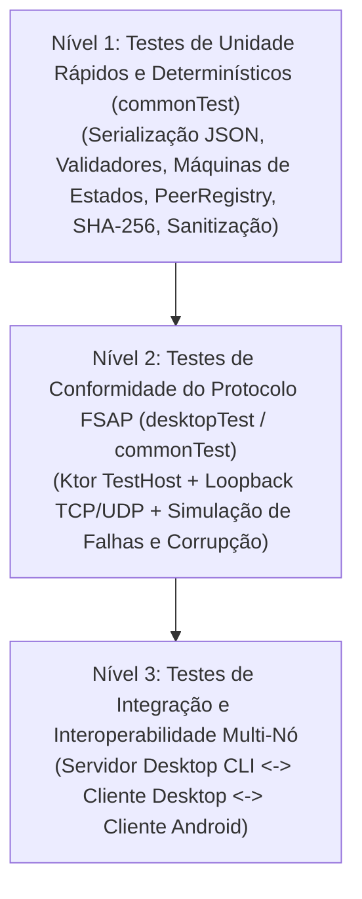

# Estratégia Geral de Testes e Garantia de Qualidade — FileShare

> **Status:** Plano de Testes (Milestone M0)  
> **Relacionado a:** [protocol-test-cases.md](file:///home/enzosarmento/Documents/2026.2/redes/fileshare/docs/protocol-test-cases.md), [backlog.md](file:///home/enzosarmento/Documents/2026.2/redes/fileshare/tasks/backlog.md)

---

## 1. Pirâmide de Testes no Kotlin Multiplatform

O projeto FileShare estrutura sua verificação em três níveis complementares dentro do monorepo:

### Nível 1: Testes Unitários em `commonTest` (`./gradlew :composeApp:desktopTest` / `testDebugUnitTest`)
Executam em milissegundos, sem abrir sockets reais do sistema operacional:
- **Serialização e Contratos FSAP:** Verifica ida e volta (*round-trip*) de todas as 12 mensagens JSON do protocolo e rejeição de payloads inválidos.
- **Máquinas de Estados (`LocalNodeState`, `PeerConnectionState`, `TransferState`):** Verifica todas as 18 transições válidas de `TransferState` e garante que qualquer transição inválida lance `InvalidStateTransitionException`.
- **`PeerRegistry` com Relógio Virtual:** Utilizando `kotlinx-coroutines-test` (`TestScope` / `advanceTimeBy`), verifica que dispositivos entram em `STALE` aos 12 s e expiram aos 18 s (`T_PEER_TTL`).
- **Sanitização e Segurança (`FileNameSanitizer`):** Testa vetores de *Path Traversal* (`../`, `..\`, bytes nulos, nomes reservados Windows) e resolução de colisões de nomes.
- **Motor de Hashing Incremental:** Verifica que o cálculo de SHA-256 em blocos de 64 KB produz o mesmo digest dos vetores de teste NIST.

### Nível 2: Testes de Conformidade de Rede em `desktopTest`
Utilizam `ktor-server-test-host` ou sockets reais em `127.0.0.1` com portas efêmeras (`port = 0`) e diretórios temporários (`Files.createTempDirectory`):
- Execução automatizada da suíte `TC-FSAP-001` a `TC-FSAP-026` ([protocol-test-cases.md](file:///home/enzosarmento/Documents/2026.2/redes/fileshare/docs/protocol-test-cases.md)).
- Injeção controlada de falhas no canal de stream (`FaultInjectingByteReadChannel`) para simular:
  - Bit-flip no meio do arquivo (validando `FSAP-ERR-422-HASH_MISMATCH` e exclusão do `.part`);
  - Queda abrupta de socket aos 50% (validando `FSAP-ERR-400-SIZE_MISMATCH` / `FSAP-ERR-503-CONNECTION_LOST`);
  - Congelamento de envio por mais de 15 s (validando `FSAP-ERR-408-STREAM_TIMEOUT`).

### Nível 3: Testes de Integração e Aceitação em Rede Local Real
Executados antes do fechamento das Milestones M2, M3, M5 e M6:
- **Cenário 1 (Mesma Máquina / Loopback):** Servidor Desktop Independente (`./scripts/run-desktop-server.sh --port 53319`) recebendo arquivos enviados pelo Cliente Gráfico Desktop (`./scripts/run-desktop-ui.sh`).
- **Cenário 2 (Desktop ↔ Desktop em LAN):** Dois computadores (Windows/Linux) na mesma rede Wi-Fi/Ethernet descobrindo-se via UDP Multicast e transferindo arquivos pequenos (10 KB) e grandes (1 GB).
- **Cenário 3 (Desktop ↔ Android em LAN):** Transferência bidirecional entre computador e smartphone Android (via Wi-Fi e via Conexão Manual por IP).

