# Grafo de Dependências e Trilhas de Paralelismo — FileShare

> **Status:** Mapeamento de Dependências e Paralelismo para Equipe de 4 Pessoas (Milestone M0 — Seção 7.2)

---

## 1. Grafo Completo de Dependências entre Tasks

O diagrama abaixo representa todas as **47 tasks** do backlog e suas dependências diretas. Nenhuma task de implementação do protocolo pode iniciar antes da aprovação da especificação (`TASK-ARC-001`).

```mermaid
flowchart TD
    subgraph M0["M0: Planejamento e Ambiente"]
        ARC001["TASK-ARC-001<br/>Aprovar Especificação FSAP"]
        ARC002["TASK-ARC-002<br/>Ratificar ADRs 004..006"]
        INF001["TASK-INF-001<br/>Validar Build KMP/Android"]
        ARC001 --> ARC002 --> INF001
    end

    subgraph M1["M1: Núcleo FSAP e Handshake Inicial"]
        INF002["TASK-INF-002<br/>CLI Servidor Desktop"]
        INF003["TASK-INF-003<br/>Logger + AppContainer"]
        FSAP001["TASK-FSAP-001<br/>DeviceIdentity + Envelope"]
        FSAP002["TASK-FSAP-002<br/>DTOs 12 Mensagens FSAP"]
        FSAP003["TASK-FSAP-003<br/>Máquinas de Estados"]
        FSAP004["TASK-FSAP-004<br/>Catálogo FsapErrorCode"]
        FSAP005["TASK-FSAP-005<br/>Validadores FSAP"]
        SEC001["TASK-SEC-001<br/>FileNameSanitizer"]
        DSRV001["TASK-DSRV-001<br/>Ktor Server + IDENTIFY"]
        DISC005["TASK-DISC-005<br/>Conexão Manual por IP"]
        TEST001["TASK-TEST-001<br/>Unit Tests Protocolo"]

        INF001 --> INF002 & INF003 & FSAP001
        ARC001 --> FSAP001
        FSAP001 --> FSAP002 & FSAP003
        FSAP002 --> FSAP004 --> FSAP005
        FSAP005 --> SEC001
        INF002 & FSAP002 & FSAP004 --> DSRV001
        FSAP002 & DSRV001 --> DISC005
        FSAP003 & FSAP005 & SEC001 --> TEST001
    end

    subgraph M2["M2: Transferência Desktop <-> Desktop"]
        SEC002["TASK-SEC-002<br/>TransferTokenManager"]
        XFER001["TASK-XFER-001<br/>Streaming 64KB + SHA256"]
        XFER002["TASK-XFER-002<br/>Client TRANSFER_REQUEST"]
        XFER003["TASK-XFER-003<br/>Client TRANSFER_CONTENT"]
        XFER004["TASK-XFER-004<br/>TransferProgressTracker"]
        XFER005["TASK-XFER-005<br/>Cancelamento Bilateral"]
        DSRV002["TASK-DSRV-002<br/>SessionManager Concorrente"]
        DSRV003["TASK-DSRV-003<br/>Rota Prepare + Aprovação"]
        DSRV004["TASK-DSRV-004<br/>Rota Content + .part + SHA256"]
        DSRV005["TASK-DSRV-005<br/>Rotas Status/Cancel/Complete"]
        DCLI001["TASK-DCLI-001<br/>Base UI Compose Desktop"]
        DCLI003["TASK-DCLI-003<br/>UI Conexão Manual IP"]
        DCLI004["TASK-DCLI-004<br/>FilePicker + NioStorage"]
        DCLI005["TASK-DCLI-005<br/>Modal Aprovação Desktop"]
        DCLI006["TASK-DCLI-006<br/>UI Progresso e Cancelar"]
        TEST002["TASK-TEST-002<br/>Testes Conformidade TCP"]

        FSAP003 --> SEC002
        FSAP001 --> XFER001
        FSAP002 & FSAP004 --> XFER002
        XFER001 & XFER002 --> XFER003
        XFER003 & FSAP003 --> XFER004
        DSRV001 & FSAP003 --> DSRV002
        DSRV002 & SEC001 & SEC002 --> DSRV003
        DSRV003 & XFER001 --> DSRV004 --> DSRV005
        XFER003 & DSRV005 --> XFER005
        INF003 --> DCLI001
        DCLI001 & DISC005 --> DCLI003
        DCLI001 & XFER001 --> DCLI004
        DCLI001 & DSRV003 --> DCLI005
        DCLI001 & XFER004 & XFER005 --> DCLI006
        DSRV005 & XFER005 --> TEST002
    end

    subgraph M3["M3: Descoberta Automática UDP"]
        DISC001["TASK-DISC-001<br/>MulticastTransport + NetIf"]
        DISC002["TASK-DISC-002<br/>Broadcaster ANNOUNCE/BYE"]
        DISC003["TASK-DISC-003<br/>Listener UDP + Jitter"]
        DISC004["TASK-DISC-004<br/>PeerRegistry + TTL 18s"]
        DCLI002["TASK-DCLI-002<br/>UI Lista de Dispositivos"]
        TEST003["TASK-TEST-003<br/>Testes Descoberta UDP"]

        FSAP001 & INF003 --> DISC001
        DISC001 & FSAP002 --> DISC002
        DISC001 & FSAP005 --> DISC003
        FSAP003 & DISC003 --> DISC004
        DCLI001 & DISC004 --> DCLI002
        DISC004 --> TEST003
    end

    subgraph M4_M5["M4 & M5: Integração e Transferência Android"]
        AND001["TASK-AND-001<br/>AndroidMulticastLock"]
        AND002["TASK-AND-002<br/>Android SAF + MediaStore"]
        AND003["TASK-AND-003<br/>FsapForegroundService"]
        AND004["TASK-AND-004<br/>UI Compose Android"]
        AND005["TASK-AND-005<br/>Fluxo Completo Android"]
        TEST005["TASK-TEST-005<br/>Interoperabilidade LAN"]

        DISC001 & DISC003 --> AND001
        XFER001 --> AND002
        AND001 & DSRV005 --> AND003
        AND002 & AND003 & DCLI002 --> AND004
        AND004 & XFER005 --> AND005
        AND005 & TEST002 & TEST003 --> TEST005
    end

    subgraph M6["M6: Segurança, Robustez e Entrega"]
        XFER006["TASK-XFER-006<br/>Desconexão e Timeouts 15s"]
        SEC003["TASK-SEC-003<br/>Limites DoS e Overflow"]
        SEC004["TASK-SEC-004<br/>TLS Opcional + Fingerprint"]
        TEST004["TASK-TEST-004<br/>Teste Carga Multi-Conexão"]
        ARC003["TASK-ARC-003<br/>Relatório Acadêmico Final"]

        XFER004 & DSRV005 --> XFER006
        DSRV004 --> SEC003 --> SEC004
        TEST002 & XFER006 --> TEST004
        TEST005 --> ARC003
    end
```

---

## 2. Caminho Crítico do Projeto

O **Caminho Crítico** (sequência mais longa de tasks dependentes que determina a duração mínima do projeto) possui **12 etapas sequenciais**:

`TASK-ARC-001` → `TASK-ARC-002` → `TASK-INF-001` → `TASK-FSAP-001` → `TASK-FSAP-002` → `TASK-FSAP-004` → `TASK-DSRV-001` → `TASK-DSRV-002` → `TASK-DSRV-003` → `TASK-DSRV-004` → `TASK-DSRV-005` → `TASK-AND-003` → `TASK-AND-004` → `TASK-AND-005` → `TASK-TEST-005` → `TASK-ARC-003`.

Qualquer atraso em `TASK-FSAP-001..004` ou nas rotas do servidor (`TASK-DSRV-001..005`) atrasa diretamente a integração final. Por isso, todas essas tasks têm prioridade máxima (`P0`).

---

## 3. Identificação de Trilhas Paralelas (Para Equipe de 4 Pessoas)

Assim que `TASK-FSAP-001` e `TASK-FSAP-002` forem concluídas no início da **M1**, o trabalho divide-se naturalmente em **4 frentes paralelas independentes** (evitando conflitos de Git nos mesmos arquivos):

| Trilha Paralela | Pacotes Isolados | Tasks que Podem Executar Simultaneamente |
| :--- | :--- | :--- |
| **Trilha A — Protocolo, Estados e Segurança** | `br.edu.fileshare.protocol.*` `br.edu.fileshare.storage.FileNameSanitizer` | `TASK-FSAP-003` (Máquinas de estados) → `TASK-SEC-001` (Sanitizador) → `TASK-SEC-002` (Token Manager) → `TASK-TEST-001` (Unit Tests em `commonTest`). |
| **Trilha B — Servidor FSAP e Recepção Binária** | `br.edu.fileshare.network.server.*` `br.edu.fileshare.desktop.server.*` | `TASK-INF-002` (CLI Server) → `TASK-DSRV-001` (Servidor Ktor + IDENTIFY) → `TASK-DSRV-002` (Sessões) → `TASK-DSRV-003` (Prepare) → `TASK-DSRV-004` (Content `.part`) → `TASK-DSRV-005` (Control). |
| **Trilha C — Cliente de Streaming, Descoberta UDP e Android Nativo** | `br.edu.fileshare.network.streaming.*` `br.edu.fileshare.network.client.*` `br.edu.fileshare.network.discovery.*` `br.edu.fileshare.android.*` | `TASK-XFER-001` (Streaming 64 KB + SHA-256) → `TASK-XFER-002`/`003` (Client Upload) → `TASK-DISC-001..004` (Descoberta UDP Multicast + `PeerRegistry`) → `TASK-AND-001..003` (MulticastLock, SAF, ForegroundService). |
| **Trilha D — Interface Gráfica Compose e Armazenamento Desktop** | `br.edu.fileshare.ui.*` `br.edu.fileshare.desktop.storage.*` | `TASK-INF-003` (Logger/DI) → `TASK-DCLI-001` (Base UI) → `TASK-DCLI-003` (Dialog IP Manual) → `TASK-DCLI-004` (FilePicker Desktop) → `TASK-DCLI-005` (Modal Aprovação) → `TASK-DCLI-006` (Tela Progresso) → `TASK-DCLI-002` (Lista Dispositivos) → `TASK-AND-004` (UI Android). |

