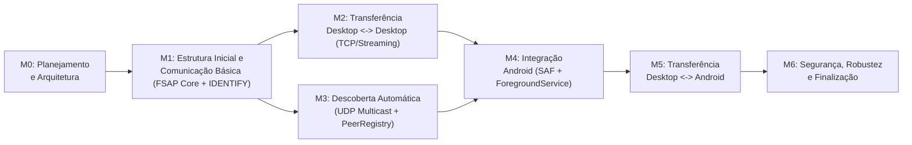

# Planejamento de Milestones e Critérios de Conclusão — FileShare

> **Status:** Planejamento de Entregas (Milestone M0 — Seções 7.1 e 7.2)  
> **Progresso de Implementação:** `0 / 47 tasks concluídas` (Todas em `TODO`).

---

## 1. Análise Crítica da Ordem das Milestones e Ajuste Proposto (Seção 7.1)

A sequência base de milestones definida para o projeto é:
- **M0:** Planejamento e arquitetura
- **M1:** Estrutura inicial e comunicação básica
- **M2:** Transferência Desktop ↔ Desktop
- **M3:** Descoberta automática
- **M4:** Integração Android
- **M5:** Transferência Desktop ↔ Android
- **M6:** Segurança, robustez e finalização

### Avaliação Arquitetural da Sequência
1. **Por que colocar `M2` (Transferência Desktop ↔ Desktop) antes de `M3` (Descoberta Automática UDP) é uma excelente decisão de engenharia:**
   - A transferência de arquivos sobre HTTP/TCP com streaming de 64 KB, validação SHA-256 e escrita `.part` é o núcleo de maior complexidade do protocolo FSAP.
   - Ao incluir a **Conexão Manual por IP (`TASK-DISC-005` / `IDENTIFY`)** logo na **M1**, a equipe consegue testar e validar 100% da transferência Desktop ↔ Desktop na **M2** em `127.0.0.1` (loopback) ou IPs fixos, sem ficar bloqueada por eventuais filtros de UDP Multicast do roteador Wi-Fi!
2. **Ajuste Recomendado para Equipe de 4 Pessoas (Paralelismo M2 ∥ M3 e M3 ∥ M4):**
   - Como o Plano de Descoberta UDP (`TASK-DISC-001` a `TASK-DISC-004`) depende apenas dos contratos da **M1** (`TASK-FSAP-001` a `005`) e **não depende** do streaming de arquivos da **M2**, a equipe não precisa esperar o término sequencial de M2 para iniciar M3:
   - Enquanto 2 ou 3 integrantes constroem o Servidor Desktop, o motor de Streaming e a UI de Transferência (**M2**), 1 integrante pode desenvolver simultaneamente o motor de Descoberta UDP Multicast e a `PeerRegistry` (**M3**) e iniciar os adaptadores Android (**M4**).

---

## 2. Detalhamento e Critérios de Conclusão por Milestone

### Milestone M0 — Planejamento e Arquitetura
- **Objetivo:** Congelar a especificação formal do protocolo FSAP/1.0, ratificar as decisões arquiteturais (ADRs) e validar o ambiente de build KMP em todas as máquinas da equipe.
- **Tasks Vinculadas (3 tasks):**
  - `TASK-ARC-001`, `TASK-ARC-002`, `TASK-INF-001`
- **Dependências de Entrada:** Nenhuma.
- **Critérios Objetivos de Conclusão (*Exit Criteria*):**
  1. Especificação do protocolo FSAP/1.0 (`docs/protocol-fsap.md` e documentos correlatos) revisada e aprovada pela equipe;
  2. ADRs `001` a `006` revisadas e com status consolidado;
  3. Todos os 4 integrantes executando `./gradlew :composeApp:desktopTest` e `./scripts/check-structure.sh` com sucesso.

---

### Milestone M1 — Estrutura Inicial e Comunicação Básica
- **Objetivo:** Implementar em `commonMain` todos os contratos do protocolo FSAP/1.0 (DTOs, serialização JSON, catálogo de erros, validadores, máquinas de estados e sanitização), erguer o Servidor Desktop Independente (`ServerMainKt`) respondendo ao handshake `IDENTIFY` e habilitar a conexão manual por IP.
- **Tasks Vinculadas (10 tasks):**
  - Infraestrutura: `TASK-INF-002`, `TASK-INF-003`
  - Protocolo FSAP: `TASK-FSAP-001`, `TASK-FSAP-002`, `TASK-FSAP-003`, `TASK-FSAP-004`, `TASK-FSAP-005`
  - Segurança Base: `TASK-SEC-001`
  - Servidor e Handshake: `TASK-DSRV-001`, `TASK-DISC-005`
  - Testes: `TASK-TEST-001`
- **Dependências de Entrada:** Conclusão da `M0` (especialmente `TASK-ARC-001`).
- **Critérios Objetivos de Conclusão (*Exit Criteria*):**
  1. 100% dos testes unitários de serialização, validadores, `FileNameSanitizer` e das 3 máquinas de estados passando em `commonTest` (`TASK-TEST-001`);
  2. O executável independente do Servidor Desktop inicia via `./scripts/run-desktop-server.sh --port 53317` sem abrir janela gráfica;
  3. Um cliente consegue realizar o handshake `IDENTIFY` por IP contra o Servidor Desktop Independente (`TC-FSAP-006` e `TC-FSAP-007` aprovados).

---

### Milestone M2 — Transferência Desktop ↔ Desktop
- **Objetivo:** Viabilizar a transferência completa de arquivos únicos e múltiplos entre instâncias Desktop (Cliente GUI ↔ Servidor Desktop Independente e Desktop ↔ Desktop na LAN via IP), com confirmação explícita do destinatário, streaming em blocos de 64 KB, escrita em arquivo `.part`, validação SHA-256, barra de progresso e cancelamento.
- **Tasks Vinculadas (16 tasks):**
  - Segurança de Sessão: `TASK-SEC-002`
  - Motor de Transferência: `TASK-XFER-001`, `TASK-XFER-002`, `TASK-XFER-003`, `TASK-XFER-004`, `TASK-XFER-005`
  - Servidor Desktop: `TASK-DSRV-002`, `TASK-DSRV-003`, `TASK-DSRV-004`, `TASK-DSRV-005`
  - Cliente Desktop GUI: `TASK-DCLI-001`, `TASK-DCLI-003`, `TASK-DCLI-004`, `TASK-DCLI-005`, `TASK-DCLI-006`
  - Testes de Conformidade HTTP/TCP: `TASK-TEST-002`
- **Dependências de Entrada:** Conclusão da `M1`.
- **Critérios Objetivos de Conclusão (*Exit Criteria*):**
  1. Suíte automatizada de conformidade `TC-FSAP-008` a `TC-FSAP-025` passando integralmente (`TASK-TEST-002`);
  2. Demonstração funcional de transferência Desktop ↔ Desktop (incluindo um arquivo de `> 200 MB`) com consumo de memória estável, aprovação explícita, barra de progresso e hash `sha256sum` idêntico no destino;
  3. Demonstração de recusa (`REJECTED`), cancelamento (`CANCELLED`) e rejeição de arquivo corrompido (`HASH_MISMATCH`) com limpeza imediata do arquivo `.part`.

---

### Milestone M3 — Descoberta Automática
- **Objetivo:** Implementar a descoberta automática de dispositivos na sub-rede local via UDP Multicast (`239.255.70.83:53318`), incluindo anúncio periódico (`ANNOUNCE` a cada 5 s), busca imediata (`DISCOVER`), saída graciosa (`BYE`), filtro de interfaces de rede e expiração automática por inatividade (`18 s`) integrada à interface gráfica.
- **Tasks Vinculadas (6 tasks):**
  - Descoberta UDP: `TASK-DISC-001`, `TASK-DISC-002`, `TASK-DISC-003`, `TASK-DISC-004`
  - Integração UI Desktop: `TASK-DCLI-002`
  - Testes de Descoberta: `TASK-TEST-003`
- **Dependências de Entrada:** Conclusão da `M1` (pode ser desenvolvida em paralelo com a `M2`).
- **Critérios Objetivos de Conclusão (*Exit Criteria*):**
  1. Casos de teste `TC-FSAP-001` a `TC-FSAP-005` aprovados (`TASK-TEST-003`);
  2. Dois computadores na mesma rede local descobrem-se automaticamente em `< 6 segundos` ao iniciar o FileShare;
  3. Ao encerrar normalmente um dispositivo, ele desaparece imediatamente da lista do colega (via `BYE`); ao desconectar o cabo/Wi-Fi abruptamente, ele expira em `18 segundos` (`T_PEER_TTL`).

---

### Milestone M4 — Integração Android
- **Objetivo:** Implementar os adaptadores nativos da plataforma Android (`WifiManager.MulticastLock`, leitura/escrita via *Storage Access Framework* / `ContentResolver` / `MediaStore.Downloads` e execução resiliente em `FsapForegroundService`).
- **Tasks Vinculadas (3 tasks):**
  - `TASK-AND-001`, `TASK-AND-002`, `TASK-AND-003`
- **Dependências de Entrada:** Conclusão do núcleo de transporte (`M2` e `M3`).
- **Critérios Objetivos de Conclusão (*Exit Criteria*):**
  1. Aplicativo Android inicia o `FsapForegroundService` com notificação ativa, adquire o `MulticastLock` e anuncia sua presença via UDP Multicast sendo descoberto por um Desktop na mesma rede Wi-Fi;
  2. Seleção de arquivos via SAF e gravação de teste via `AndroidFileSink` (`cacheDir` → `MediaStore.Downloads`) funcionando sem erros de permissão no Android 10–15.

---

### Milestone M5 — Transferência Desktop ↔ Android
- **Objetivo:** Integrar as telas Compose Multiplatform no Android e homologar transferências bidirecionais completas entre Desktop e Android (e Android ↔ Android).
- **Tasks Vinculadas (3 tasks):**
  - `TASK-AND-004`, `TASK-AND-005`, `TASK-TEST-005`
- **Dependências de Entrada:** Conclusão da `M4`.
- **Critérios Objetivos de Conclusão (*Exit Criteria*):**
  1. Transferências bem-sucedidas e verificadas por SHA-256 nos sentidos:
     - **Desktop → Android**
     - **Android → Desktop**
     - **Desktop → Desktop**
     - **Android → Android** (quando 2 dispositivos/emuladores em bridge estiverem disponíveis)
  2. Confirmação explícita de recebimento, progresso em tempo real e cancelamento funcionando em ambas as plataformas.

---

### Milestone M6 — Segurança, Robustez e Finalização
- **Objetivo:** Endurecer o sistema contra desconexões abruptas, timeouts de leitura de stream, exaustão de disco/memória, validar múltiplas conexões simultâneas sob carga e consolidar a documentação acadêmica para apresentação final.
- **Tasks Vinculadas (6 tasks):**
  - Robustez e Concorrência: `TASK-XFER-006`, `TASK-TEST-004`
  - Segurança Avançada: `TASK-SEC-003`, `TASK-SEC-004`
  - Documentação Final: `TASK-ARC-003`
  - Homologação Final: revisão integral de `TASK-TEST-005`
- **Dependências de Entrada:** Conclusão da `M5`.
- **Critérios Objetivos de Conclusão (*Exit Criteria*):**
  1. Todos os 26 casos de teste de conformidade (`TC-FSAP-001` a `TC-FSAP-026`, incluindo múltiplas conexões simultâneas) aprovados;
  2. Nenhum arquivo `.part` órfão ou vazamento de recurso após testes de queda forçada de Wi-Fi;
  3. Relatório acadêmico e código-fonte prontos para entrega e demonstração ao professor.

